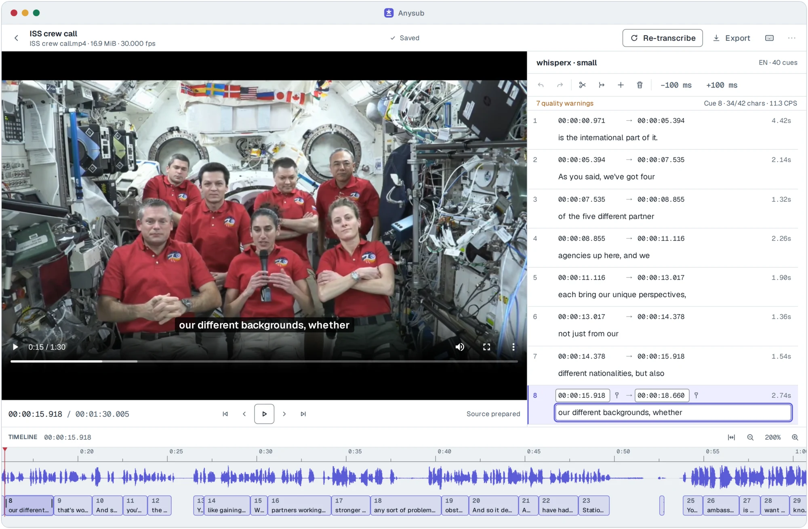

<p align="center">
  
</p>

<h1 align="center">Anysub</h1>

Anysub (formerly Whishper) makes subtitles from audio and video. Upload a recording, let Whisper transcribe it, then fix the text and timing in the editor and export. It runs on your own computer or server.

<p align="center">
  
</p>

## Features

- Transcription with Whisper, from the `tiny` model to `large-v3-turbo`.
- Word-level timings.
- A subtitle editor with a waveform timeline, undo and autosave.
- Warnings for subtitles that are too fast, too long, or overlap.
- Export to SRT, WebVTT, plain text or JSON.
- Uploads that resume, for hours-long files.
- A searchable library.
- Admin pages for models, defaults, upload limits, disk space and workers.

## Install

You need Linux on x86-64 with Docker and Docker Compose.

1. Create a folder and download the Compose file:

   ```sh
   mkdir anysub && cd anysub
   curl -fsSLO https://github.com/pluja/anysub/releases/latest/download/compose.yaml
   ```

2. **Optional, NVIDIA GPU only.** Skip to step 3 if you don't have an NVIDIA GPU. Otherwise, download the GPU file into the same folder and turn it on. You need the [NVIDIA Container Toolkit](https://docs.nvidia.com/datacenter/cloud-native/container-toolkit/latest/install-guide.html) and a GTX 16xx, RTX 20xx or newer card.

   ```sh
   curl -fsSLO https://github.com/pluja/anysub/releases/latest/download/compose.cuda.yaml
   echo "COMPOSE_FILE=compose.yaml:compose.cuda.yaml" >> .env
   ```

3. Start Anysub:

   ```sh
   docker compose up -d
   ```

4. Open `http://localhost:5173` and create your account. It asks for a setup code, which `docker compose logs web` shows.

A GPU transcribes several times faster than a CPU. AMD and Intel GPUs aren't supported yet, but we plan to add them.

[Install](docs/INSTALL.md) covers Podman, reverse proxies and building from source. [NVIDIA GPUs](docs/GPU.md) helps when the GPU doesn't work.

## Coming from Whishper 3

Whishper 3 is no longer maintained, and Anysub can't read its data. [Coming from Whishper 3](docs/MIGRATING-FROM-WHISHPER.md) explains how to move over. The old code is in the [`v3-legacy`](https://github.com/pluja/anysub/tree/v3-legacy) branch.

## Not built yet

- Translation.
- Speaker labels.
- Watched folders.
- Import from a URL or an existing subtitle file.
- More than one account.
- Workers on other machines.
- ARM images.

These will come in 4.x releases. See the [changelog](CHANGELOG.md).

## Documentation

See [docs](docs/README.md).

## AI disclosure

Large language models helped write the code and docs. A human reviews and tests every change before it ships.

## License

[AGPL-3.0-only](LICENSE).
